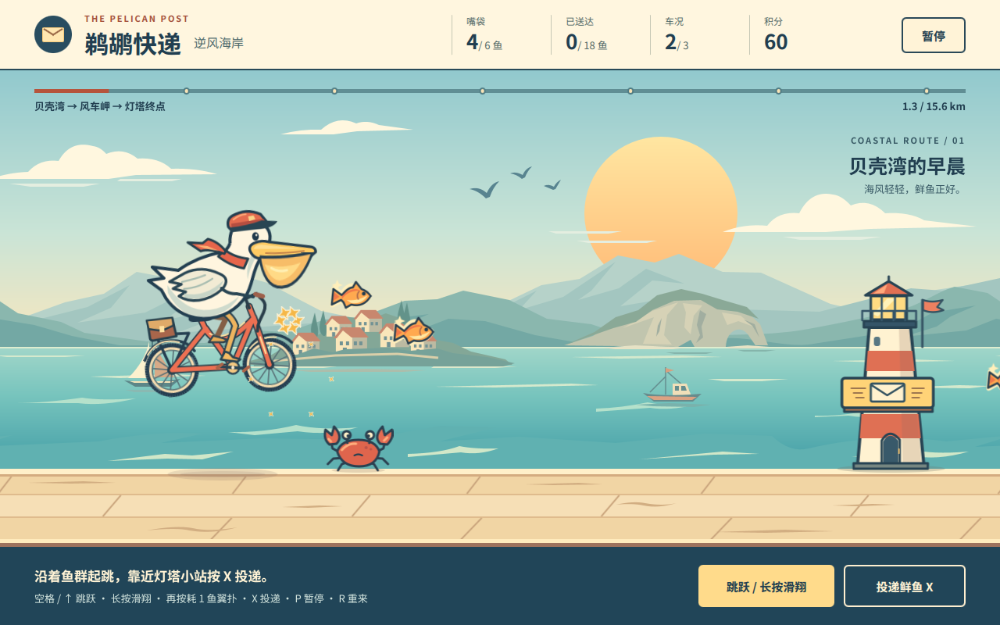
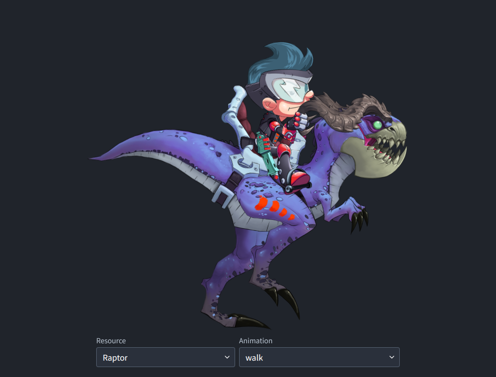
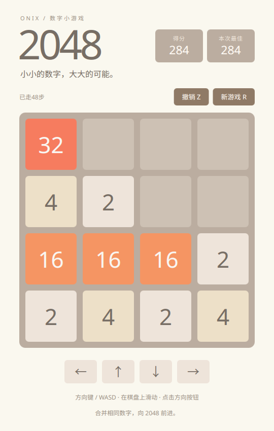
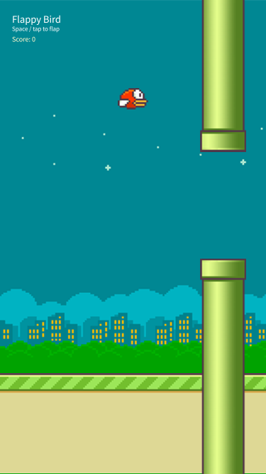
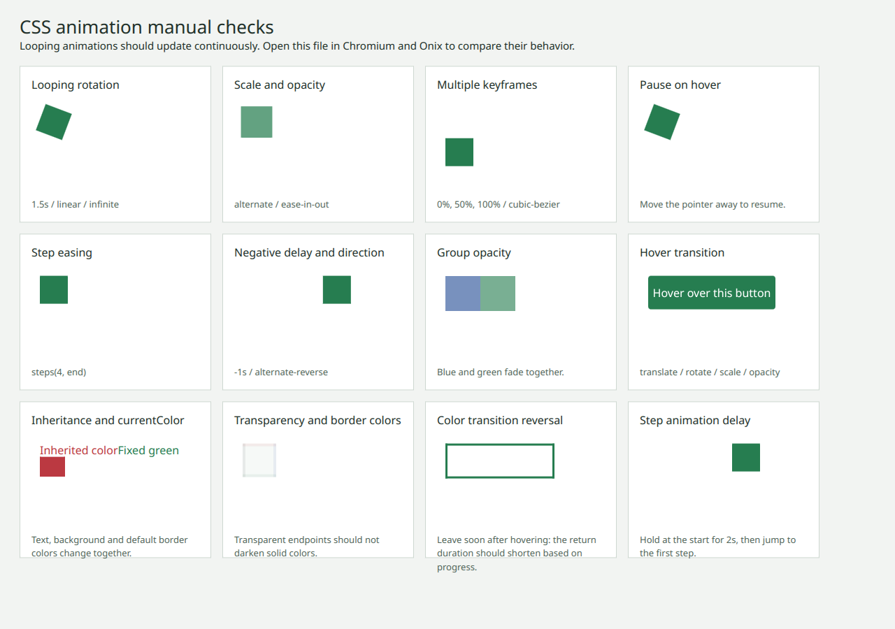
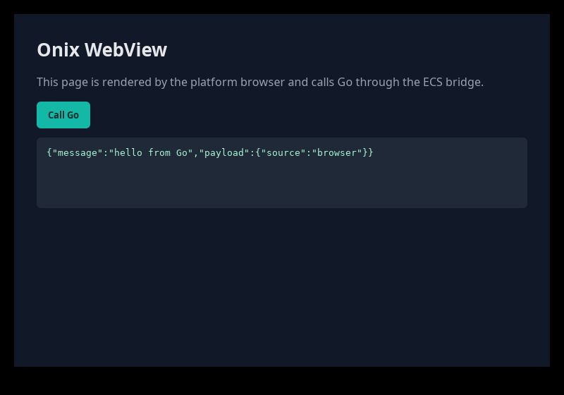

# Onix

[简体中文](README.zh-CN.md) · [Supported platforms](#supported-platforms) · [Quick start](#quick-start) · [Examples](#examples) · [Docs](docs/README.md) · [☆ Star on GitHub](https://github.com/onix-engine/onix)

Onix is a Go engine for 2D and 3D games and interactive applications. Write gameplay in Go, build menus and HUDs with HTML/CSS, and use the project editor or CLI to package the same project for desktop, mobile, the web and WeChat Mini Games.

## Supported platforms

| Windows | macOS | Linux | Android | iOS | Web | WeChat Mini Games |
| :---: | :---: | :---: | :---: | :---: | :---: | :---: |
|  |  |  |  |  |  |  |

## Engine features

- **Typed gameplay code.** Define components as Go types and query entities by the data a system needs. Change filters let systems skip unchanged components, and typed messages connect gameplay modules. [ECS API](docs/engine/ecs-api-design.md) · [Module guide](docs/project/module-system-authoring.md)
- **Native HTML/CSS rendering. Onix lays out and draws the UI alongside the game scene without a browser or WebView.** Update text and attributes from Go through DOM handles, and use CSS keyframes and transitions to animate controls. [Native HTML and scrolling](docs/ui/html.md) · [CSS animations](docs/ui/html-css-animations.md)
- **2D and 3D scenes.** Animate sprites and Spine skeletons in 2D, or light glTF models with physically based materials and HDR environments in 3D. Both have physics systems for collision and rigid-body simulation. [Lighting and materials](docs/rendering/render-lighting.md) · [2D physics](docs/physics/physics2d.md) · [3D physics](docs/physics/physics3d.md)
- **On-demand rendering.** Use continuous rendering for a moving scene, or let a static screen rest until input, a tracked change or an animation requests a frame. [Frame scheduling](docs/engine/design.md#scheduling-and-preparation)
- **Platform-specific builds.** The build pipeline compiles the selected graphics backend and prepares its shaders and textures. [Release platforms](#release-platforms) · [Resource packages](docs/project/resource-packages.md)

## Release platforms

Choose a target in **Build Project** or pass its ID to the CLI with `-platform`. Each build uses one renderer. The default for each target appears in bold.

| Target | Build output | Renderers | Build and release notes |
| --- | --- | --- | --- |
| Windows (`windows`) | Portable ZIP or MSI installer | **DirectX 11**, Vulkan, OpenGL | Build with MinGW-w64 on Windows or Linux. MSI packaging also requires WiX or wixl. |
| macOS (`macos`) | `.app` bundle or `.dmg` disk image | **Metal**, Vulkan, OpenGL | Build a universal or single-architecture app on macOS, or cross-compile it on Linux with osxcross. Creating a DMG requires macOS. |
| Linux (`linux`) | `.tar.gz` containing the executable and resources | **OpenGL**, Vulkan | Build on Linux for the host architecture. |
| Android (`android`) | ARM64 APK | **Vulkan**, OpenGL ES | Requires the Android SDK, NDK, CMake and JDK 17+. Sign the release APK with your publishing key. |
| iOS (`ios`) | ARM64 static library (`libonix.a`) and Swift host files | **Metal** | Build on macOS, add the generated files to an Xcode target, then archive and sign the app in Xcode. |
| Web (`web`) | Static site with HTML, JavaScript and WebAssembly | **WebGPU**, WebGL 2 | Deploy the generated directory to a web server. WebGPU requires HTTPS or localhost. |
| WeChat Mini Games (`wechat`) | Mini Game project with a WebAssembly runtime | **WebGL 2** | Set your Mini Game AppID and open the generated directory in WeChat DevTools to upload it. |

[Desktop packaging and cross-compilation](docs/platform/desktop-builds.md) · [Android toolchain](docs/platform/android-builds.md) · [iOS host integration](editor/templates/ios/host/README.md)

## Quick start

With Go 1.27+, Git and your platform’s native build dependencies installed, create a project alongside the engine checkout. [Build requirements](#prerequisites)

```sh
git clone https://github.com/onix-engine/onix.git
cd onix
go run ./editor/cmd/onix new ../my-game
go run ./editor/cmd/onix check ../my-game
go run ./editor/cmd/onix ../my-game
```

The last command opens the editor for the new project. Use **Play** to build and
run it, or **Build Project** to package it. Running `go run ./editor/cmd/onix`
without arguments opens the editor's New/Open workflow.

## Examples

| Screenshot | Example source | Engine features in use |
| :---: | --- | --- |
| [](examples/damaged_helmet/screenshot.webp) | [Damaged Helmet](examples/damaged_helmet/) | glTF materials and reflections under HDR environment lighting. Model by theblueturtle_ and ctxwing, environment by Greg Zaal. [Asset licenses](examples/damaged_helmet/README.md#资源来源) |
| [](examples/pelican/screenshot.webp) | [The Pelican Post](examples/pelican/) | Parallax scrolling with SVG sprites and an HTML/CSS HUD. |
| [](examples/spine/screenshot.webp) | [Spine gallery](examples/spine/) | Switch between eight skeletons and their animations at runtime. |
| [](examples/2048/screenshot.webp) | [2048](examples/2048/) | Go move and undo logic updates an HTML/CSS board through DOM handles. |
| [](examples/flappybird/screenshot.webp) | [Flappy Bird](examples/flappybird/) | Typed messages connect the input, simulation and sprite modules. |
| [](examples/animations/screenshot.webp) | [CSS animations](examples/animations/) | Native CSS keyframes, transitions and hover interactions. |
| [](examples/webview/screenshot.webp) | [WebView](examples/webview/) | A page in the platform WebView calls a Go handler. |
| [](examples/hello_world/screenshot.webp) | [Hello World](examples/hello_world/) | Open a window and render text from a single Go file. |

## Prerequisites

- **Go 1.27 or newer** and Git.
- **A C/C++ toolchain** with CGO enabled for native builds. Linux requires the X11, Xext, Xrender, Xi, Wayland, wayland-cursor and xkbcommon development libraries, plus OpenGL for the default renderer. On macOS, install Xcode Command Line Tools.
- Packaging and cross-compilation require the target platform’s tools. [Desktop builds](docs/platform/desktop-builds.md) · [Android builds](docs/platform/android-builds.md)

## Command reference

All commands below run from the engine checkout. Options precede the project
directory.

| Task | Command |
| --- | --- |
| Create a project | `go run ./editor/cmd/onix new ../my-game` |
| Validate a project | `go run ./editor/cmd/onix check ../my-game` |
| Regenerate registration | `go run ./editor/cmd/onix generate ../my-game` |
| Open a project in the editor | `go run ./editor/cmd/onix ../my-game` |
| Build a desktop release for the host platform | `go run ./editor/cmd/onix build -mode release ../my-game` |
| Build a Web release | `go run ./editor/cmd/onix build -platform web -mode release ../my-game` |

`generate` preserves the application's `main.go`. Builds collect and preprocess
resources, then produce platform-specific artifacts under the project's `dist/`.
Release builds use the `onix_release` tag and binary resource packages.

## Documentation

Find project and platform guides, UI and rendering references, physics, and
engine development topics in the [documentation index](docs/README.md).

## Engine development

Read [AGENTS.md](AGENTS.md) before changing the engine. Prefer concise generic
implementations, minimize allocations on warm paths, and combine traversals when
possible. HTML rendering changes must follow W3C standards and align with Chromium.

Run tests for the packages affected by a change. For example, for ECS work:

```sh
go test ./ecs
go test ./ecs -run TestName -count=1
```

Replace `TestName` with the relevant test name or pattern. **Do not run
`go test ./...`**; the repository-wide suite can freeze the machine. Visual
acceptance is manual; do not launch the editor for automated screenshot testing.

## License

Onix is licensed under the [MIT License](LICENSE). You may use, modify, compile,
and distribute the engine, including in commercial games and software, subject
to the license's notice requirements. Third-party code and assets retain their
own licenses; see [third-party notices](THIRD_PARTY_NOTICES.md).
