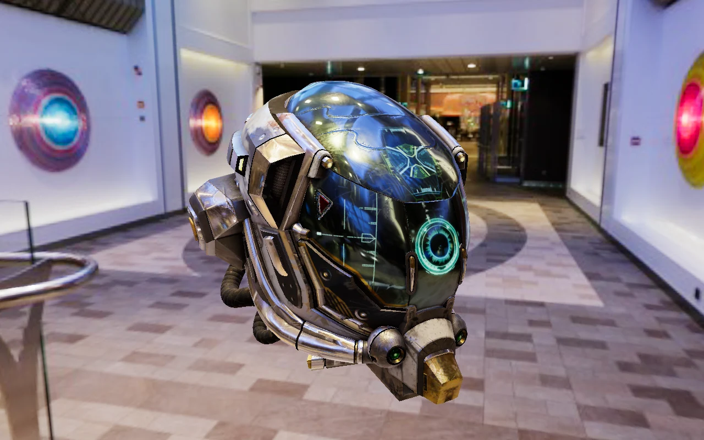
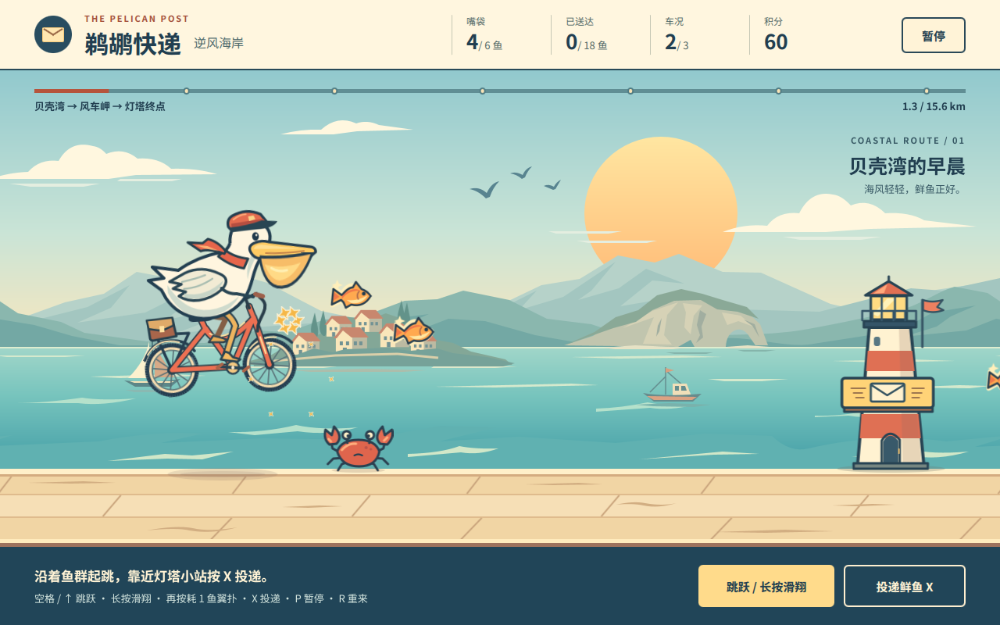
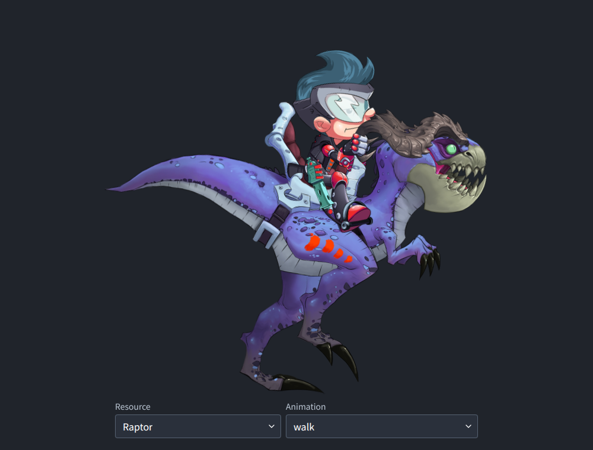
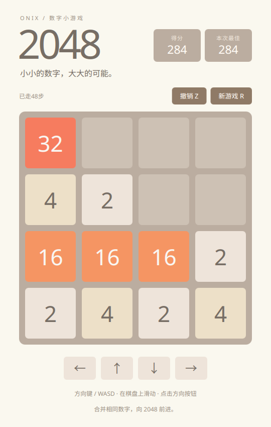
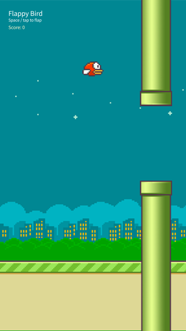
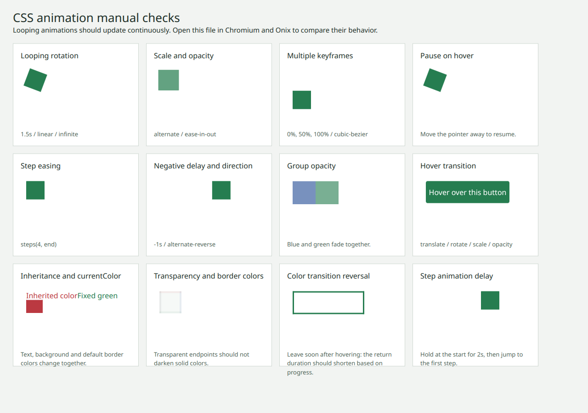
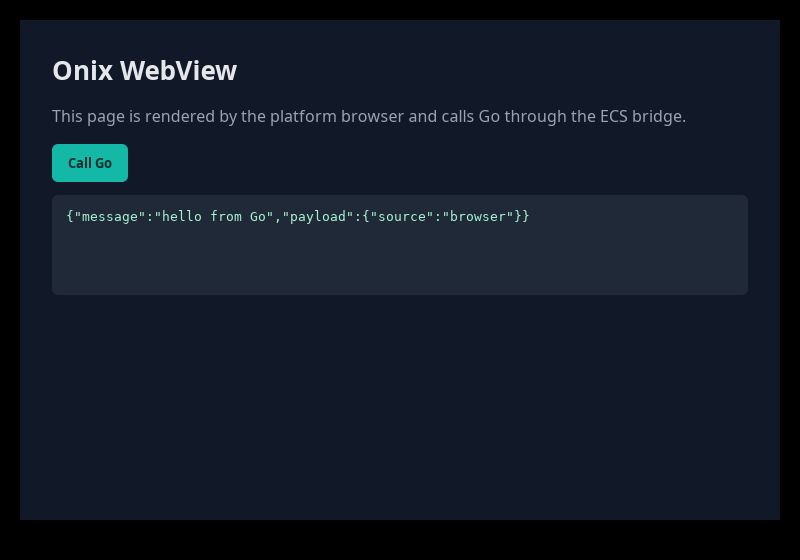

# Onix

[English](README.md) · [支持的平台](#支持的平台) · [快速开始](#快速开始) · [示例](#示例) · [开发文档](docs/README.zh-CN.md) · [☆ 在 GitHub 上 Star](https://github.com/onix-engine/onix)

Onix 是用 Go 编写的 2D/3D 游戏与交互应用引擎。用 Go 写玩法，用 HTML/CSS 制作菜单和 HUD，再通过项目编辑器或命令行把同一个项目打包到桌面、移动端、Web 和微信小游戏。

## 支持的平台

| Windows | macOS | Linux | Android | iOS | Web | 微信小游戏 |
| :---: | :---: | :---: | :---: | :---: | :---: | :---: |
|  |  |  |  |  |  |  |

## 引擎特色

- **用 Go 类型组织游戏逻辑。** 组件直接定义为 Go 类型，系统按所需组件查询实体，也可以只处理发生变化的数据。玩法模块之间通过类型化消息传值。[ECS API](docs/engine/ecs-api-design.md) · [模块开发](docs/project/module-system-authoring.md)
- **原生渲染 HTML/CSS 界面，无需浏览器或 WebView。** Onix 负责界面的布局和绘制，并将它与游戏场景显示在同一个窗口。用 Go 通过 DOM 句柄更新文字和属性，用 CSS 关键帧和过渡制作控件动效。[原生 HTML 与滚动](docs/ui/html.md) · [CSS 动画](docs/ui/html-css-animations.md)
- **2D 与 3D 场景。** 在 2D 场景里编排精灵和 Spine 骨骼动画，在 3D 场景里用基于物理的材质与 HDR 环境光呈现 glTF 模型。两者都有碰撞检测和刚体模拟。[光照与材质](docs/rendering/render-lighting.md) · [2D 物理](docs/physics/physics2d.md) · [3D 物理](docs/physics/physics3d.md)
- **按需渲染。** 动态场景可以连续出帧，静态界面可以等到输入、数据变化或动画需要刷新时再绘制。[帧调度](docs/engine/design.zh-CN.md)
- **面向目标平台构建。** 构建流程编译选定的图形后端，并为它准备着色器和纹理。[发布平台支持](#发布平台支持) · [资源打包](docs/project/resource-packages.md)

## 发布平台支持

在编辑器的 **Build Project** 中选择平台，或在命令行用 `-platform` 指定表中的平台标识。每次构建使用一个渲染后端，粗体为该平台的默认选项。

| 目标平台 | 构建产物 | 渲染后端 | 构建与发布条件 |
| --- | --- | --- | --- |
| Windows（`windows`） | 便携 ZIP 包或 MSI 安装包 | **DirectX 11**、Vulkan、OpenGL | 在 Windows 或 Linux 上使用 MinGW-w64 构建。制作 MSI 还需 WiX 或 wixl。 |
| macOS（`macos`） | `.app` 应用包或 `.dmg` 磁盘映像 | **Metal**、Vulkan、OpenGL | 支持通用二进制和单架构应用，可在 macOS 上构建，也可在 Linux 上用 osxcross 交叉编译。制作 DMG 需要 macOS。 |
| Linux（`linux`） | 含可执行文件和资源的 `.tar.gz` 压缩包 | **OpenGL**、Vulkan | 在 Linux 上按构建机的 CPU 架构打包。 |
| Android（`android`） | ARM64 APK | **Vulkan**、OpenGL ES | 需要 Android SDK、NDK、CMake 和 JDK 17+。发布前需用自己的密钥为 Release APK 签名。 |
| iOS（`ios`） | ARM64 静态库（`libonix.a`）和 Swift 宿主文件 | **Metal** | 在 macOS 上构建，将生成文件加入 Xcode 应用目标，再通过 Xcode 归档和签名。 |
| Web（`web`） | 包含 HTML、JavaScript 和 WebAssembly 的静态站点 | **WebGPU**、WebGL 2 | 将生成目录部署到 Web 服务器。WebGPU 需要 HTTPS 或 localhost。 |
| 微信小游戏（`wechat`） | 含 WebAssembly 运行时的小游戏工程 | **WebGL 2** | 设置小游戏 AppID，在微信开发者工具中导入生成目录并上传。 |

[桌面打包与交叉编译](docs/platform/desktop-builds.md) · [Android 工具链](docs/platform/android-builds.md) · [iOS 宿主集成](editor/templates/ios/host/README.md)

## 快速开始

装好 Go 1.27+、Git 和对应平台的原生构建依赖后，运行以下命令，在引擎仓库旁创建自己的项目。[构建环境要求](#环境要求)

```sh
git clone https://github.com/onix-engine/onix.git
cd onix
go run ./editor/cmd/onix new ../my-game
go run ./editor/cmd/onix check ../my-game
go run ./editor/cmd/onix ../my-game
```

最后一条命令会打开新项目的编辑器。使用 **Play** 构建并运行项目，使用
**Build Project** 打包项目。不带参数执行 `go run ./editor/cmd/onix`，
则进入编辑器的新建／打开项目流程。

## 示例

| 运行截图 | 示例源码 | 使用的引擎功能 |
| :---: | --- | --- |
| [](examples/damaged_helmet/screenshot.webp) | [Damaged Helmet](examples/damaged_helmet/) | glTF 材质与 HDR 环境反射。模型由 theblueturtle_ 和 ctxwing 制作，环境图由 Greg Zaal 制作。 [素材许可](examples/damaged_helmet/README.md#资源来源) |
| [](examples/pelican/screenshot.webp) | [鹈鹕快递](examples/pelican/) | SVG 精灵、视差滚动和 HTML/CSS 游戏界面。 |
| [](examples/spine/screenshot.webp) | [Spine 动画库](examples/spine/) | 运行时切换八套骨骼及其动画。 |
| [](examples/2048/screenshot.webp) | [2048](examples/2048/) | 用 Go 实现移动和撤销，通过 DOM 句柄更新 HTML/CSS 棋盘。 |
| [](examples/flappybird/screenshot.webp) | [Flappy Bird](examples/flappybird/) | 通过类型化消息连接输入、模拟和精灵绘制模块。 |
| [](examples/animations/screenshot.webp) | [CSS 动画](examples/animations/) | 由引擎绘制的 CSS 关键帧、过渡和悬停交互。 |
| [](examples/webview/screenshot.webp) | [WebView](examples/webview/) | 系统 WebView 中的网页调用 Go 函数。 |
| [](examples/hello_world/screenshot.webp) | [Hello World](examples/hello_world/) | 用一个 Go 文件打开窗口并绘制文字。 |

## 环境要求

- **Go 1.27 或更高版本**及 Git。
- **C/C++ 工具链**，原生构建需启用 CGO。Linux 需要 X11、Xext、Xrender、Xi、Wayland、wayland-cursor 和 xkbcommon 开发库，默认渲染后端还需要 OpenGL。macOS 需要 Xcode Command Line Tools。
- 打包和交叉编译另需目标平台的工具。[桌面构建](docs/platform/desktop-builds.md) · [Android 构建](docs/platform/android-builds.md)

## 常用命令

以下命令均在引擎仓库根目录执行，选项放在项目目录参数之前。

| 操作 | 命令 |
| --- | --- |
| 创建项目 | `go run ./editor/cmd/onix new ../my-game` |
| 校验项目 | `go run ./editor/cmd/onix check ../my-game` |
| 重新生成注册代码 | `go run ./editor/cmd/onix generate ../my-game` |
| 在编辑器中打开项目 | `go run ./editor/cmd/onix ../my-game` |
| 为宿主桌面平台构建发布版本 | `go run ./editor/cmd/onix build -mode release ../my-game` |
| 构建 Web 发布版本 | `go run ./editor/cmd/onix build -platform web -mode release ../my-game` |

`generate` 保留应用的 `main.go`。构建流程会收集、预处理资源，并将平台产物输出到
项目的 `dist/` 下。发布构建使用 `onix_release` 标签和二进制资源包。

## 开发文档

[文档索引](docs/README.zh-CN.md)收录项目与平台指南、界面与渲染参考、物理和引擎开发文档。

## 引擎开发约定

修改引擎前请阅读 [AGENTS.md](AGENTS.md)。优先使用简洁的泛型实现，尽量减少
热路径分配，并合并可复用的遍历。HTML 渲染修改应遵循 W3C 标准并与 Chromium 对齐。

仅运行改动涉及的包测试。例如修改 ECS 时：

```sh
go test ./ecs
go test ./ecs -run TestName -count=1
```

将 `TestName` 替换为相关测试名称或匹配表达式。**禁止运行 `go test ./...`**，
全仓库测试可能导致机器卡死。视觉验收由人工完成，不要启动编辑器进行自动截图测试。

## 许可证

Onix 使用 [MIT 许可证](LICENSE)。在遵守许可证声明保留要求的前提下，
可以使用、修改、编译和分发本引擎，包括用于商业游戏和软件。
第三方代码与资源保留各自的许可证，详见[第三方声明](THIRD_PARTY_NOTICES.md)。
