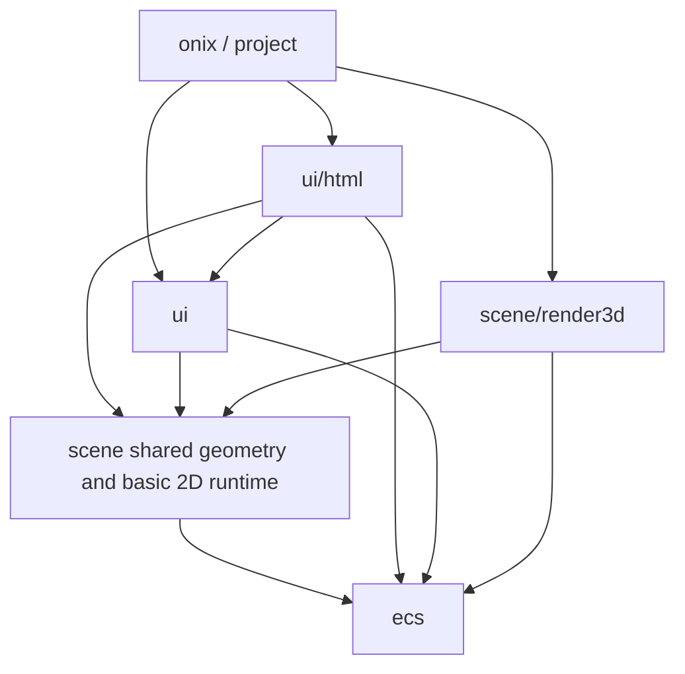

# ECS API design review

This historical review led to the eight completed phases documented in the
[implementation record](ecs-api-implementation.md). It describes design intent;
use the implementation record for final names, measurements and migration outcomes.

Go 1.27 method names and slot ownership are documented in the
[generic-method migration](ecs-generic-methods.md).

## Access and iteration

Optional pointer access returns *T and uses nil for absence: GetRef/GetMut and Slot
variants need no redundant bool. Value Get keeps (T,bool), since zero is valid.
World.MustMut/EntitySlot.MustMut express installation-verified invariants and diagnose entity/type.
Resources retain presence booleans because a stored nil pointer can be present.
SceneInstance.Component supports low-frequency named access; RequireComponent validates
and returns an EntitySlot for repeated access. Cache handles rather than component
pointers; generations/World checks reject stale or foreign Slots. Rebind on scene replacement.

Unify Query/Read/ReadRef/QueryAccess through Query1..7 views and .All range. Components
expose Get (copy), Ref (borrowed read-only convention), Mut (mark that column Changed),
and CommitComponent (compare before write for comparable values). Go cannot enforce
Ref immutability. Query views replaced a direct iter.Seq2 prototype that allocated
four times per call. Keep archetype column binding, query cursors and filter caching
shared; generate typed arities from one template rather than variable generic parameters.
Break/return/panic must release query guards. Borrow access only within iteration;
Commands handle structural mutations. In borrows an ordered list of checked entity handles.

MessageReader.All borrows pointers for normal range control flow, advancing the cursor
before body entry. Early exit preserves unread messages; copying remains explicit.
Discard skips current messages in O(1) for that reader without clearing shared buffers.
Range and generics do not prove zero allocations or speedups: measure inlining and callers.

## Script runtime

Generate static Script[T]/Hooks[T] declarations with concrete method expressions,
leaving installation/removal/traversal to a shared generic runtime. Hooks include
Install/Update/Input/Destroy/InputMask; avoid per-entity reflection, name lookup,
interface probing and closures. Registration can allocate once. Compare indirect
function costs against concrete generated methods before choosing the final hot path.

Registry order makes type execution deterministic; bindings specify entity order.
Scene-owned entity lists prevent scripts from updating another scene sharing a World
and script type. Bind/remove/clone/replace maintain membership. Cache per-depth scene
contexts for reentry without per-entity escaping allocations; restore outer context.
Install follows component insertion so input listeners work. Failures must remove
partial components/routes; Update errors release queries. Never retain borrowed contexts.

## UI updates and lookup

Use SetIfChanged for optional comparable values. SetText/SetPosition/SetSize compare
only target fields, preserving noncomparable text layout caches and unrelated transforms;
do not use reflect.DeepEqual or overwrite cached components. Cache validated Slots at
installation and compare presentation state before formatting strings. Force initial
application and preserve time-dependent updates. Missing-versus-unchanged semantics
must remain explicit when absence is an error.

Expose existing HTML NodeByID/EntityGroups indexes through ControlByID, scoped to a
surface, preserving first-ID document order and generation checks. DOM replacement,
renaming and entity rebuild invalidate associations. Before synchronization a DOM node
may have no entity. Use UI domain operations for live values so dirty DOM values,
selection, composition and TextField state stay synchronized. Do not collapse attribute
defaults and dirty live values into one field.

Replace repeated label/option scans with a parent index in O(T+K), preserving original
match semantics. FindPart is preferable when templates establish semantic unique parts;
first-part lookup cannot silently replace last-match behavior for ambiguous labels.
Iterate entities without retaining pointers across migrations.

## Typed creation and structural changes

NodeSpawner[T] binds the seven-component UI node layout once, Reserve prepares capacity,
and Spawn accepts NodeOptions plus content. Defaults are visible, TopLeft and valid
transforms; reject duplicate fixed component types. Avoid creating a new factory per
spawn or variadic any hot APIs. Dynamic loading can use Bundle; repeated static content
uses PreparedBundle and typed spawners, installing final structure in one operation.

PrepareRemoval caches old-to-target archetypes. Process old columns once, cleaning
removed components and copying retained values, then update entity/swapped-row metadata.
Removing K components separately from M repeatedly moves (M-1)+(M-2)+...+(M-K)
columns; one plan processes the old set once. Extend to Patch1..8 mixed writes/removals
with typed command streams. Preserve Added/Changed ticks, cleanup hooks, generations,
World isolation and released-payload cleanup. One migration does not promise rollback
of hook effects or external resources. Active queries queue rather than mutate storage.

## Package boundaries

ECS owns entities/storage/queries/commands/schedule/resources/messages. Scene owns
Parent/Transform/Visibility/SiblingOrder, cameras, shared 2D geometry, input and animation.
UI owns container layout, widget constraints, controls, semantic parts and text interaction.
HTML owns DOM integration/reconciliation; render3d owns optional 3D extraction/materials/
systems over graphics/render. Project loads scene/prefab/module data; onix composes features.
Use generic resources, removal hooks and registration boundaries without import cycles
or UI calls embedded in ECS. Migrate APIs first, then packages, removing aliases directly.

An initial proposal moved all 2D drawing into scene/render2d and UITransform into ui.
Drawing/input/animation/layout share sizes/anchors/clips/text metrics, so the final design
retains basic 2D runtime in scene and moves only upper-level Layout/Widget to ui. Splitting
packages is architectural work; binary-size/build/runtime benefits require measurements.
Original source classification counted about 26,498 top-level ECS lines, including 9,926
HTML-prefixed and 4,914 render-prefixed, plus 10,815 in the former ecs/ui. The remainder
was not necessarily pure ECS; file prefixes were only an approximate classification.

## Delivery and acceptance

Implement access/query/script/UI/index APIs, then node factories and structural plans,
then split packages against stable interfaces. Cover early/error/panic iteration,
Changed/Added windows, nesting, Commands, multi-scene scripts, deterministic order,
installation failure/replacement, cleanup, generation reuse and swapped rows. Record
ns/op, B/op and allocs/op, separating initialization from warm steady paths. World/index
creation, growth, dynamic strings and business callback allocations remain separate.
Use bounded explicit package checks; no whole-repository test command, editor screenshot
testing or subagents. See the implementation record for measured gains and regressions.
