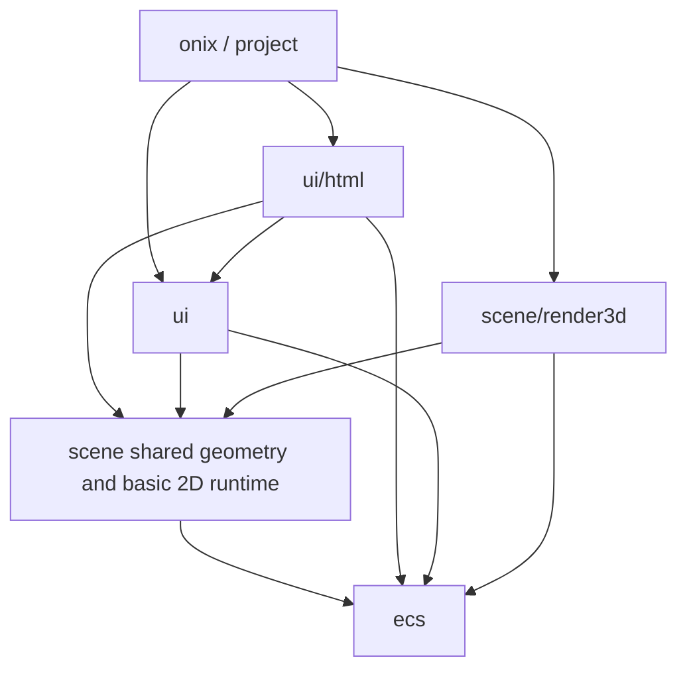

# ECS API and ownership

This guide describes the current ECS access, iteration, structural-change and
package-boundary contracts. Performance expectations are summarized in the
[performance guide](performance.md).

## Access and iteration

Optional pointer access returns *T and uses nil for absence: GetRef/GetMut and Slot
variants need no redundant bool. Value Get keeps (T,bool), since zero is valid.
World.MustMut/EntitySlot.MustMut express installation-verified invariants and diagnose entity/type.
Resources retain presence booleans because a stored nil pointer can be present.
SceneInstance.Component supports low-frequency named access; RequireComponent validates
and returns an EntitySlot for repeated access. Cache handles rather than component
pointers; generations/World checks reject stale or foreign Slots. Rebind on scene replacement.

Use typed query views with `.All` for iteration. `Get` copies a value, `Ref`
borrows a read-only reference by convention, and `Mut` marks the component
changed. `CommitComponent` compares comparable values before writing. Borrow
access only within iteration and use commands for structural changes. `In`
borrows an ordered list of checked entity handles.

MessageReader.All borrows pointers for normal range control flow, advancing the cursor
before body entry. Early exit preserves unread messages; copying remains explicit.
Discard skips current messages in O(1) for that reader without clearing shared buffers.

## Frame maintenance and query scopes

`App.Step` calls `World.Maintain` after drawing. When driving a World directly,
call it once at the end of each frame after iterators, borrowed rows and
component references, and drawing snapshots are finished. Maintenance may
move component storage while preserving archetype and column identity.

`QueryScope.Reset(nil)` clears members and cached state. `ReleaseCache` retires
compiled membership and scoped values while retaining the borrowed member
list. An unused scope also releases its cache after 30 maintenance calls.
Reacquire scoped values when reusing a scope after either form of retirement.

## Script runtime

Generate static Script[T]/Hooks[T] declarations with concrete method expressions,
leaving installation/removal/traversal to a shared generic runtime. Hooks include
Install/Update/Input/Destroy/InputMask; avoid per-entity reflection, name lookup,
interface probing and closures. Registration can allocate once. Compare indirect
function costs against concrete generated methods before choosing the final hot path.

Registry order makes type execution deterministic; bindings specify entity order.
Scene-owned entity lists prevent scripts from updating another scene sharing a World
and script type. Bind/remove/clone/replace maintain membership. Cache per-depth scene
contexts for reentry without per-entity escaping allocations; restore outer context.
Install follows component insertion so input listeners work. Failures must remove
partial components/routes; Update errors release queries. Never retain borrowed contexts.

## UI updates and lookup

Use SetIfChanged for optional comparable values. SetText/SetPosition/SetSize compare
only target fields, preserving noncomparable text layout caches and unrelated transforms;
do not use reflect.DeepEqual or overwrite cached components. Cache validated Slots at
installation and compare presentation state before formatting strings. Force initial
application and preserve time-dependent updates. Missing-versus-unchanged semantics
must remain explicit when absence is an error.

Expose existing HTML NodeByID/EntityGroups indexes through ControlByID, scoped to a
surface, preserving first-ID document order and generation checks. DOM replacement,
renaming and entity rebuild invalidate associations. Before synchronization a DOM node
may have no entity. Use UI domain operations for live values so dirty DOM values,
selection, composition and TextField state stay synchronized. Do not collapse attribute
defaults and dirty live values into one field.

Replace repeated label/option scans with a parent index in O(T+K), preserving original
match semantics. FindPart is preferable when templates establish semantic unique parts;
first-part lookup cannot silently replace last-match behavior for ambiguous labels.
Iterate entities without retaining pointers across migrations.

## Typed creation and structural changes

NodeSpawner[T] binds the seven-component UI node layout once, Reserve prepares capacity,
and Spawn accepts NodeOptions plus content. Defaults are visible, TopLeft and valid
transforms; reject duplicate fixed component types. Avoid creating a new factory per
spawn or variadic any hot APIs. Dynamic loading can use Bundle; repeated static content
uses PreparedBundle and typed spawners, installing final structure in one operation.

PrepareRemoval caches old-to-target archetypes. Process old columns once, cleaning
removed components and copying retained values, then update entity/swapped-row metadata.
Removing K components separately from M repeatedly moves (M-1)+(M-2)+...+(M-K)
columns; one plan processes the old set once. Extend to Patch1..8 mixed writes/removals
with typed command streams. Preserve Added/Changed ticks, cleanup hooks, generations,
World isolation and released-payload cleanup. One migration does not promise rollback
of hook effects or external resources. Active queries queue rather than mutate storage.

## Package boundaries

ECS owns entities, storage, queries, commands, schedules, resources and messages.
Scene owns hierarchy, transforms, visibility, cameras, shared 2D geometry, input
and animation. UI owns container layout, widget constraints, controls and text
interaction. HTML owns DOM integration and reconciliation. `scene/render3d` owns
optional 3D extraction, materials and systems over `graphics`/`render`. Project
loads scene and module data. `onix` composes engine features. Keep these
boundaries free of import cycles and UI-specific calls inside ECS.

## Delivery and acceptance

Tests for ECS changes should cover early exit and panic cleanup, change-filter
windows, nested iteration, queued structural changes, entity generation reuse and
swapped rows. Measure initialization separately from warmed steady paths. Use
focused package checks for the packages affected by a change.
