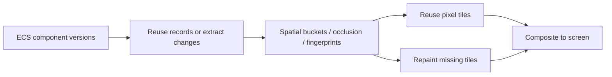

# Incremental 2D rendering and tiled composition

Recorded 2026-10-21 against baseline d83c274616a82459c757842e3263666f4d74c444.
Five optimizations extend ExtractRender2DSystem → RenderCamerasSystem. Eligible UI
outputs use them by default: static frames retain drawing records/color attachments;
local changes update affected tiles; broad animation uses direct rendering.

| Optimization | Implementation |
| --- | --- |
| Retained records / incremental extraction | Entity Sprite/Text snapshots, ECS versions, retained sort positions when count/keys stay fixed |
| Damage tracking | Fingerprints include paint, transforms, clipping, texture versions and order; movement/deletion restore old pixels; hidden changes skip rasterization |
| Persistent targets / partial repaint | Keep RGBA attachments, clear dirty tiles, replay intersections in paint order, composite unchanged frames |
| Shared property state | Reuse incremental UI transform metadata for scene/layers/target/stack; integer translation and clip edits reuse snapshots; text re-extracts beyond overscan |
| Tile cache / occlusion | 128x128 tiles; one reverse scene pass builds spatial buckets, fingerprints and conservative occlusion; translated content maps to existing physical tiles without pixel copies |

The design draws from [Blink paint](https://chromium.googlesource.com/chromium/src/+/HEAD/third_party/blink/renderer/platform/graphics/paint/README.md)
and [Chromium cc](https://chromium.googlesource.com/chromium/src/+/HEAD/cc/README.md).
It is synchronous engine composition, without Chromium's full four property trees,
separate compositor thread or active/pending trees.



Draw items retain paint-state pointers into entity records to reduce direct-path
copies. Dense writes above max(16, entities/4) extract sequentially; changes to over
half the target's tiles without reuse select direct drawing to avoid offscreen bandwidth.

## Measurement

Linux: i5-11500, Go 1.26.0, linux/amd64, GOMAXPROCS=2. Android device ABR-AL80 reports
x86_64 and the same CPU; these numbers do not represent ARM phone GPU performance.
Each 1280x720 scene has 1,000 or 10,000 10x5 UI rectangles in 100 columns spaced
12 horizontally and 6 vertically. After eight warm frames, use 500ms runs, three
repetitions, median shown. Baseline and changed binaries use the same benchmark
and run sequentially with no concurrent builds.

Timing includes ECS writes, extraction, visibility and Canvas submission into a
counting mock driver. It excludes GPU work, HTML style/layout, actual Present and
whole-frame FPS. Recolor alternates two colors; one-item movement alternates x=0/600;
scroll shifts every item by 128 pixels; occlusion changes an item behind a full-screen
opaque panel. Instance counts include tile background resets and final composition;
cross-tile items can be repeated. These are not draw-call counts. No ablation study
separates the five optimizations' individual contributions.

## Linux results

| Elements | Scenario | Before ms/frame | After ms/frame | CPU time ratio (before/after) | After instances/frame |
| ---: | --- | ---: | ---: | ---: | ---: |
| 1,000 | Static | 0.843121 | 0.001549 | 544.30× | 1.0 |
| 1,000 | Recolor one | 0.846653 | 0.061341 | 13.80× | 86.0 |
| 1,000 | Move one | 0.821175 | 0.080029 | 10.26× | 146.5 |
| 1,000 | Scroll all 128 px | 0.855624 | 0.185523 | 4.61× | 86.0 |
| 1,000 | Recolor all | 0.849110 | 0.796066 | 1.07× | 1,000.0 |
| 1,000 | Update behind opaque panel | 0.824504 | 0.025230 | 32.68× | 1.0 |
| 10,000 | Static | 9.568418 | 0.001495 | 6400.28× | 1.0 |
| 10,000 | Recolor one | 10.078457 | 0.414959 | 24.29× | 152.1 |
| 10,000 | Move one | 9.771305 | 0.470601 | 20.76× | 284.5 |
| 10,000 | Scroll all 128 px | 9.642739 | 2.877676 | 3.35× | 325.8 |
| 10,000 | Recolor all | 9.775292 | 9.761883 | 1.00× | 10,000.0 |
| 10,000 | Update behind opaque panel | 9.678324 | 0.209471 | 46.20× | 1.0 |

## Android x86 results

| Elements | Scenario | Before ms/frame | After ms/frame | CPU time ratio (before/after) | After instances/frame |
| ---: | --- | ---: | ---: | ---: | ---: |
| 10,000 | Static | 9.366896 | 0.001374 | 6817.25× | 1.0 |
| 10,000 | Recolor one | 9.149611 | 0.378027 | 24.20× | 152.1 |
| 10,000 | Move one | 9.300171 | 0.405626 | 22.93× | 284.5 |
| 10,000 | Scroll all 128 px | 9.660840 | 2.896945 | 3.33× | 325.7 |
| 10,000 | Recolor all | 9.419172 | 9.268018 | 1.02× | 10,000.0 |
| 10,000 | Update behind opaque panel | 9.304600 | 0.181788 | 51.18× | 1.0 |

All six modes on both platforms use 0 B/op and 0 allocs/op after warmup, including
the baseline. Static speedups reflect skipped CPU extraction/sorting/submission,
not proportional FPS improvements. Cold caches, structural changes, new glyphs and
driver-internal allocations are outside that claim.

## Correctness and scope

Recorded targeted scene/graphics/ui/html/ui/root tests and vet passed. Nine Android
incremental-render tests covered snapshot/order reuse, scope, hide/restore, movement,
deletion, occlusion, integer translation, clipping, textures, budgets, resizing,
animation recovery, text release and overlays. Xvfb/Vulkan lavapipe compared replayed
composition attachments byte-for-byte with full rendering for scrolling, fractional
clipping/translation, transparency, rotation, LCD text/shadows, 1.25x density, edits,
ordering and deletion. No editor screenshots were taken.

Only opaque axis-aligned rectangles fully covering a tile, without rounded corners
or borders, occlude. Fractional clips round inward; rounded clips do not occlude.
Pixel caching currently applies to the first ordinary opaque 2D UI screen camera.
World/3D, transparent or overlay outputs, custom shaders/materials, external/dynamic
render-target textures, effects and unsupported targets draw directly. Some direct
paths still reuse retained records; direct Draw2D extracts immediately.

Integer translation can reuse records; pixel reuse also requires identical relative
content/clipping within tiles. Verified 128-pixel-aligned scrolling reuses tiles;
continuous/fractional scrolling can repaint most tiles. Changed frames still scan
items to rebuild buckets; there is no maintained per-entity spatial index. Text needs
128 * rasterScale to be integral, otherwise direct rendering is used. Densities
1, 1.25, 1.5 and 2 satisfy this condition.

Default color-cache budget is 64 MiB. A 1280x720 RGBA8 target is 3,686,400 bytes
(3.52 MiB), split into 60 tiles; CPU records/buckets and backend overhead are extra.
Camera exit, size/device changes or lost eligibility release targets. App shutdown
calls RenderWorld.Dispose().

```go
ecs.InsertResource(world, scene.CompositeSettings2D{MaxCacheBytes: 32 << 20})
// Zero selects the default budget; negative disables pixel caching.
```

Preparation2D reports Extracted/Reused/Sorted/PropertiesUpdated. Composite2D reports
DirtyTiles/ReusedTiles/RasterPixels/Submitted/Occluded/CacheBytes/Direct. Submitted
counts replayed items and RasterPixels counts dirty tile area; neither is GPU time
or complete fragment work. Notify ECS via GetMut/SetIfChanged and textures via
UpdateRegions/SetSourceRect/SetLogicalSize to invalidate content.

## Reproduction

```sh
GOMAXPROCS=2 go test -p 1 ./scene ./graphics ./ui/html ./ui . -count=1 -timeout=180s
GOMAXPROCS=2 go vet -p 1 ./scene ./graphics ./ui/html ./ui .
GOMAXPROCS=2 go test -p 1 ./scene -run '^$' -bench '^BenchmarkIncrementalRender2D$' -benchmem -benchtime=500ms -count=3
xvfb-run -a env VK_DRIVER_FILES=/usr/share/vulkan/icd.d/lvp_icd.json LP_NUM_THREADS=2 GOMAXPROCS=2 go test -p 1 ./scene -run '^TestNativeComposite2DMatchesFullRender$' -count=1 -v -timeout=120s
```

The baseline lacked Dispose, so only that fixture cleanup call was omitted there.
Both versions were compiled to separate test binaries before timing. Temporary
baseline worktrees were removed. Android used NDK 27.2.12479018 x86_64-linux-android24-clang
with GOOS=android GOARCH=amd64 CGO_ENABLED=1 and -trimpath. Push the binary and test
fonts; make ../testdata point to the same fixture directory for outputTestFont.

Raw results: [Linux before](benchmarks/render-linux-before.txt),
[Linux after](benchmarks/render-linux-after.txt),
[Android before](benchmarks/render-android-before.txt),
[Android after](benchmarks/render-android-after.txt).
Validation: [Linux](benchmarks/render-linux-tests.txt),
[Android](benchmarks/render-android-tests.txt),
[Vulkan pixels](benchmarks/render-vulkan-pixels.txt).
