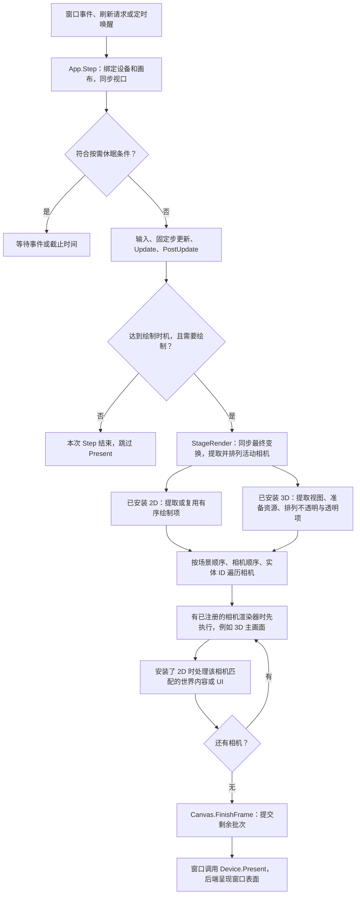
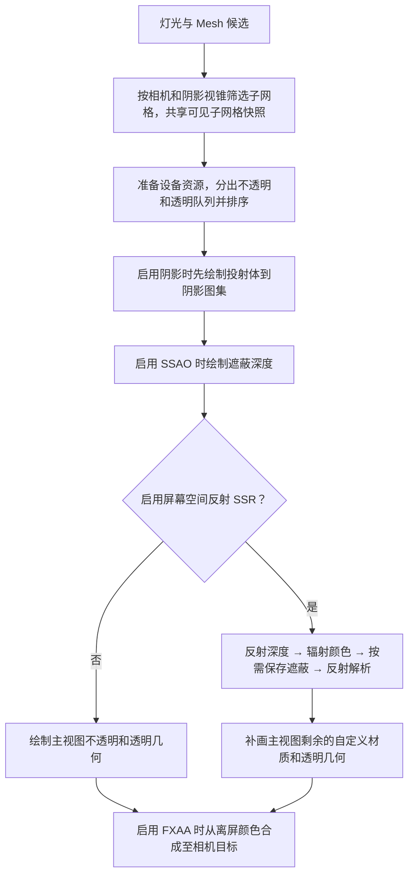

# Onix 渲染路径与优化方案

2026-11-20，基于 `5f2cae5` 及当前工作区。范围是应用运行时的 ECS、引擎内 HTML/UI、2D/3D 相机和窗口提交。数据来自 Linux amd64 的定向 CPU 基准。

## 一帧如何到达屏幕



2D 和 3D 提取框表示可选的系统依赖。相机绘制遵循同一份有序列表。引擎内 HTML 在更新阶段处理样式和布局，把绘制结果发布为 UI 实体或 `UIPaintList2D`，随后进入 2D 提取。离屏目标可供后续绘制采样。切换目标、部分绘制状态或图元类型时，Canvas 可以在帧中途提交批次。[帧循环](../app_ecs.go) · [系统依赖](../app_systems.go) · [HTML 绘制列表](../ui/html/paint_list.go) · [相机提取](../scene/render_world.go) · [相机执行](../scene/render_registered.go) · [Canvas](../graphics/canvas2d.go) · [窗口呈现](../window/event_loop.go)

提交时，Sprite 和 Shape 走各自的实例批次，3D 会合并连续且状态兼容的网格实例。纹理和静态网格在需要时取得当前设备的句柄，动态几何和实例数据随批次交给驱动。具体构建使用 OpenGL/ES、Vulkan、Metal、DirectX、WebGL2 或 WebGPU 后端。以 Vulkan 为例，帧末提交命令缓冲，再呈现交换链图像。[设备接口](../render/device.go) · [3D 实例合并](../scene/render3d/renderer.go) · [Vulkan 提交与呈现](../render/vulkan_native.c)

### 2D 绘制的三条常用路径

| 内容变化 | CPU 准备 | 画面输出 |
| --- | --- | --- |
| 静止的可缓存 UI，窗口仍要求出帧 | 复用保留树和瓦片内容 | 直接采样缓存纹理。瓦片仍在原槽位时只画一个全屏四边形 |
| 局部改色、移动、显隐 | 稀疏更新沿用顺序，合成器根据旧、新边界更新受影响瓦片和遮挡关系。成员或顺序变化可触发重建 | 一个离屏目标内按裁剪区域重画脏瓦片，再合成到窗口。完全遮挡的改动可能无需重画瓦片 |
| 密集内容更新、世界精灵、透明叠加或其他不满足缓存条件的输出 | 密集内容可切换为顺序收集和排序。保留树有效但合成不适用时，仍可复用绘制项 | 按相机过滤并按绘制顺序提交。Sprite、Shape、Mesh 使用各自的批次 |

瓦片为 128 × 128，默认缓存预算 64 MiB。合成器要求相机输出到窗口、负责不透明清屏、使用预乘 Alpha 混合，且可见绘制项支持缓存。已有窗口相机先绘制时，后续叠加层走直接绘制。当前工作区还会让单个可缓存且宽高都不超过 128 的绘制项直接绘制。瓦片槽位会在滚动时复用，槽位发生重排后按瓦片采样输出。[保留树](../scene/render_retained2d.go) · [瓦片合成与回退](../scene/render_composite2d.go) · [局部损伤](../scene/render_composite_damage2d.go)

### 一台 3D 相机的几何与效果顺序



3D 的透明项按距离从远到近排序。主视锥外的物体仍可能投影到画面内。点光源可需要六个阴影视图，方向光按级联分配视图。FXAA 处理该相机的完整颜色，随后才叠加相应 UI。[提取、排序与绘制](../scene/render3d/renderer.go) · [阴影](../scene/render3d/shadows.go) · [SSAO](../scene/render3d/ssao.go) · [SSR](../scene/render3d/ssr.go) · [FXAA](../scene/render3d/fxaa.go)

## 当前成本

Intel i5-11500、Go 1.27.3，每组运行 300 ms，取三次中位数。2D 使用 1280 × 720 的测试驱动、1 万个 UI Shape，计入测试所做的 ECS 写入、2D 提取、相机绘制和 FinishFrame。3D 使用两个相机、1,000 个共享网格与材质的立方体，计至构建不透明实例批次。两组均未计入 GPU 执行和窗口 Present。

| 暖路径负载 | CPU 耗时/次 | Sprite 与 Shape 实例/次 |
| --- | ---: | ---: |
| 2D 静止，强制出帧 | 1.57 µs | 1 |
| 2D 改色一项，完全被遮挡 | 7.37 µs | 1 |
| 2D 改色一项，可见 | 61.4 µs | 152 |
| 2D 移动一项 | 111.6 µs | 约 285 |
| 2D 全体水平平移 128，模拟整块滚动 | 2.16 ms | 325 |
| 2D 全体改色 | 7.22 ms | 10,000 |
| 3D 双相机准备 | 0.744 ms | — |

实例数包含清理脏区和最终合成所用的图元，多个实例可以合并为一次 draw call。滚动组写入每个实体的最终变换，可用于观察渲染器处理密集平移的成本；实际 HTML 列表还要单独测布局、滚动容器与绘制裁剪。滚动组短样本报告 164–170 B/op，其他表列组报告 0 B/op。[2D 基准](../scene/render_incremental_bench_test.go) · [3D 基准](../scene/render3d/benchmark_test.go)

## 建议的实施顺序

| 优先级 | 删除或合并的工作 | 实施与验收 |
| --- | --- | --- |
| 先做，改动小 | **2D Shape 重复计算基矩阵。** 视口剔除和裁剪均调用同一绘制项的 `quadTransform()` | 在单次绘制内计算一次，传给两处。六轮交替 A/B 的中位数从 7.171 降至 7.040 ms，约 **1.8%**。比较不同锚点、旋转、圆角裁剪和屏外物体。[实现](../scene/render2d.go) |
| 先做，改动小 | **3D 在每个资源查找点重新取得世界绑定的设备。** 同一准备阶段共用这台设备 | 在进入视图循环前取得一次 `DeviceFor(world)`。同一双相机基准从 0.762 降至 0.733 ms，约 **3.7%**。保留每个设备自己的资源句柄及上传错误处理。[资源准备](../scene/render3d/renderer.go) · [设备绑定](../graphics/frame_context.go) |
| 结构改动首选 | **密集改色触发通用的整批提取。** 全体改色 CPU 采样中，约 41% 在提取，约 45% 在 Shape 绘制。两者有各自的优化空间 | 先给颜色动画的写入路径记录“仅填充色变化”。对成员、几何、顺序和路由稳定的 Shape，直接更新有序快照或实例颜色，沿用直接绘制，跳过重新收集、排序和重复几何准备。任意组件写入仍须检查或回退。先限制为 Alpha 与可见性都稳定的改色。验收看 `Preparation2D.Extracted`、`Sorted`、CPU 时间和最终像素，10,000 个实际可见实例仍需绘制。[提取判定](../scene/render_retained2d.go) · [排序及提交](../scene/render_registered.go) |
| 长列表优先 | **整块平移逐项更新属性，又逐项计算瓦片覆盖。** 滚动采样约 59% 在提取，约 31% 在合成。现有实现已经能复用移位后的瓦片像素 | 让滚动容器传递位移和固定裁剪区，用内容局部坐标保留子项。先覆盖纯平移且滚动前后可复用像素的容器，按位移重定位缓存并重画新露出的区域和独立变化的内容。嵌套裁剪、sticky、亚像素位移和点击坐标要与当前结果对照。用真实长列表再测 `PropertiesUpdated`、`PreparedItems`、`RasterPixels` 和 CPU p95。[瓦片准备](../scene/render_composite2d.go) · [HTML 滚动同步](../ui/html/scroll_sync.go) · [真实 HTML 路径的基准](../ui/html/paint_cull_test.go) |
| 多相机 3D 优先 | **每个相机重复求子网格世界中心和缩放半径。** 双相机采样约 66% 在提取，`containsSphere` 约占总样本 16% | 先在同帧首次需要某个子网格时算出世界包围球，主视图和阴影视图共享输入，各自保留视锥判定。CPU 变形采用更新后的边界，GPU 变形沿用保守可见性。分别测 1、2、4 个相机，包括视锥不相交和仅阴影可见的物体，并记录新增暂存容量。[视图提取](../scene/render3d/renderer.go) |

A/B 使用临时 Go overlay，每项单独改动，每轮 650 ms，六轮交替基线和实验的先后顺序。结果是上述基准的 CPU 耗时变化，两项均只在临时构建中验证。采样百分比来自各负载独立的 3 秒 CPU profile，父子函数的累计占比有重叠。

### 何时值得进一步减少 GPU 工作

- **静态窗口先省整帧。** `RenderOnDemand` 可跳过渲染和 Present；事件驱动的工具面板还可开启 `SetIdleEnabled(true)`，在符合条件时连主更新也跳过。动画、插入符号和自定义定时更新应能请求下一帧或安排唤醒。需要连续刷新的窗口，即使缓存命中仍须向当前窗口表面合成。若分析高分辨率下的稳定帧，可先验证按合成器版本直接复用上次的槽位映射，跳过重复瓦片扫描。[按需调度](../app_ecs.go) · [休眠条件](../app_idle.go) · [合成器](../scene/render_composite2d.go)
- **阴影先测每个投影的成本。** 若目标设备采样显示图集绘制占主要 GPU 时间，先缓存静态点光源或聚光灯的阴影区域。光源投影、投射体增删或移动、蒙皮、Alpha Mask 纹理、图集布局变化都应使对应区域失效。方向光级联还须跟踪相机。验收看实际少画的阴影视图和整帧 GPU 毫秒，覆盖主视锥外的投射体。[阴影图集](../scene/render3d/shadows.go) · [阴影提交](../scene/render3d/renderer.go)
- **SSAO 和 SSR 深度只有在输入等价时才可共享。** 两者的分辨率、投影、参与几何和材质筛选可能不同，例如自定义着色器几何对反射射线仍可产生遮挡。先在目标后端采集每个 pass 的时间与目标切换次数，再决定是否为等价组合复用深度。[SSAO](../scene/render3d/ssao.go) · [SSR](../scene/render3d/ssr.go) · [各 pass 的筛选](../scene/render3d/renderer.go)

## HTML 同步路径的优化优先级

以下测量从 DOM 写入或滚动位置更新开始，计至引擎内 `ui/html.Sync` 返回。测试使用 Linux amd64、i5-11500、Go 1.27.3 和预热后的单个 Surface。表内为三次基准的耗时中位数，2D 提取、GPU 和窗口呈现均在计时范围之外。

| 操作 | 输入规模 | 每次同步 |
| --- | --- | ---: |
| 只切换一个节点的文字颜色 class | 10 / 1,000 / 10,000 个无关兄弟 | 12.3 / 12.2 / 12.6 µs |
| 只替换一段短文字，行高稳定 | 10 / 1,000 个无关兄弟 | 17.6 / 18.5 µs |
| 同一滚动列表在缓冲区内移动 / 在 400 和 800 px 偏移间切换 | 1,000 行，视口高 80 px，每行高 20 px | 1.08 / 222 µs |
| 背景和边框颜色动画 | 100 个元素 | 128 µs |
| 改动容器外文字，分别移除 / 启用一条命中的容器查询规则 | 同一布局，1,000 个无关兄弟 | 21.7 µs / **8.47 ms** |

### 1. 缩小容器查询触发的样式重算

对照场景的容器宽度固定为 200 px，一条 `@container (min-width: 150px)` 规则将其子元素高度设为 42 px。计时循环仅交替替换容器外的 `Before` 和 `After`。当前有两次从文档根开始的样式计算。样式表编译时将容器条件标记为需要文档级更新，局部文字变更因此选中文档根。局部布局之后，查询收敛的第一轮又从文档根计算一次。CPU 采样分别在这两个调用点累计 2.21 s 和 2.18 s，总样本 4.49 s。[规则编译](../html/style/matcher.go) · [变更根选择](../ui/html/incremental.go) · [布局与查询收敛](../ui/html/surface.go)

**先跳过尺寸稳定时的第二次计算，再缩小第一次计算的范围。** 临时 Go overlay 仅在已有布局、单处纯文字变更、变更节点位于查询容器外且容器尺寸集合不变时，跳过收敛阶段的重复级联。相同页面、相同生效规则，各运行三次、每次 350 ms，独立 A/B 中位数从 **8.07 ms 降至 3.99 ms**。该实验保留了第一次整页重算。进一步可在已有布局遍历中记录查询容器和尺寸变化，在相应依赖子树重算样式。新建、移动或改名的容器，样式表与视口变化，以及阈值跨越均须使对应依赖失效。以嵌套和具名容器、尺寸跨阈值、重挂载的完整重算结果作对照，并用 `SyncStats.Styled` 检查访问规模。

### 2. 长列表跨缓冲边界时，只更新变化行的绘制实体

规则叶子行已经有纵向索引。1,000 行和 10,000 行列表都只检查了 **51 个裁剪盒子**，且两者的布局次数均为零。但各有 40 个绘制实体移出、40 个移入后，文档会从根重建所属实体列表，分别访问 **1,002 和 10,002 个盒子**。1,000 行 CPU 采样中，约 78% 落在变更盒子的绘制实体更新，约 10% 在重建所属实体列表。[裁剪与实体更新](../ui/html/paint_cull.go) · [所属实体列表](../ui/html/owner_spans.go)

先为简单静态文字和背景行复用绘制绑定，减少进出行重复走创建、变换初始化和滚动路由的成本。把变化行的实体区间合并后批量修补所属列表；安排位置时须计入裁剪实体、滚动条和文档顺序。验收时固定视口，将行数从 1,000 扩到 10,000，观察 `OwnerListBoxes`、实际创建/退休实体数和耗时，并验证文本、嵌套裁剪、点击与焦点。

### 3. 纯颜色动画直接更新对应的绘制属性

当前已按活动节点采样并合并有共同祖先的变化。100 个元素的背景色和边框色动画中，约 **74%** 的 CPU 样本位于通用的 `applyHTMLAnimatedVisual` 调用内，其中包含父级变换、透明度、文字状态和最终着色。可在采样时记录实际变化的属性，仅背景或边框色变化时更新对应视觉项。前景色变化继续传播到继承色和 `currentColor` 的使用者。验收覆盖透明到可见的过渡、非均匀边框、圆角遮罩、同帧祖先变换和子元素改色。[动画遍历与变换](../ui/html/animation.go) · [绘制属性更新](../ui/html/animation_paint.go)

现有负载可用下列命令复测。容器查询的对照与滚动工作量计数来自本次临时探针。实验只测引擎 HTML 同步，移动端与 Chromium 像素对照属于实施后的验证。

```sh
go test ./ui/html -run '^$' -bench '^(BenchmarkHTMLLocalClassMutation|BenchmarkHTMLLocalTextMutation|BenchmarkHTMLPaintCullBufferedScroll|BenchmarkHTMLPaintCullMovedScroll|BenchmarkHTMLCSSColorAnimationFrame)$' -benchtime=200ms -benchmem -count=3
```

## HTML 内存

用同一个 80 px 高的滚动容器，分别挂载 100、1,000 和 10,000 行。每行高 20 px，包含相同的背景色和三个字符。每个规模使用三个独立 Linux amd64 进程，以预热字体和 HTML 路径后的堆为基线。下表取两次 GC 后 `HeapAlloc` 增量的中位数，包含当前 ECS 世界及文档。测量截止于 HTML 同步，不含后续 2D 提取、驱动显存或进程 RSS。[现有测量接口](../ui/html/metrics.go) · [滚动场景](../ui/html/paint_cull_test.go)

| 行数 | 首次挂载后的存活堆 | 滚动 64 次后的存活堆 | 滚动后的布局盒 / 绘制子实体 |
| ---: | ---: | ---: | ---: |
| 100 | 0.36 MiB | 0.46 MiB | 102 / 63 |
| 1,000 | 2.15 MiB | 2.27 MiB | 1,002 / 63 |
| 10,000 | 20.07 MiB | 20.32 MiB | 10,002 / 63 |

10,000 行时仍保留 20,002 个 DOM 节点、10,000 个文字片段和 30,000 个字形槽位。20,002 个节点的计算样式已共享为 4 个不同的样式对象。这一页由 HTML 自己持有的纹理像素数为零。滚动限制了绘制实体数量，布局、文字和每个盒子的绘制记录仍随总行数增长。[布局盒](../html/layout/box.go) · [绘制记录](../ui/html/partial.go)

| 建议顺序 | 证据 | 实施与验证 |
| --- | --- | --- |
| 1. 换小文档时回收大表 | 同一 Surface 从 10,000 行替换成 100 行，再同步并维护世界 64 次，存活堆为 3.21 MiB。直接挂载 100 行为 0.36 MiB。临时构建在文档替换时释放动画基线表和 overflow 尺寸表，测得 **3.21 → 1.81 MiB**，回收 **1.41 MiB** | 正式实现可按新旧规模差或持续低利用率决定是否缩容。交替验证大→小、大→大和重新增长，记录存活堆及挂载分配量。[文档替换](../ui/html/document.go) · [动画基线](../ui/html/animation.go) · [overflow 表](../ui/html/surface.go) |
| 2. 共享行继承的裁剪窗口 | 10,000 行滚动后有 10,001 份裁剪快照，按完整内容比较只得到 4 个不同的值。每份为 152 B。按此场景完全去重，可省约 **1.45 MiB 的结构载荷**，尚未扣除共享管理开销 | 让相同的行引用不可变的继承窗口，遇到独立裁剪或滚动位置变化时切换对应快照。限制历史窗口的保留量，并验证反向滚动、嵌套裁剪和原有暖路径分配。[裁剪快照](../ui/html/paint_cull.go) |
| 3. 缩小普通叶子行的布局与绘制状态 | 10,000 行的存活堆采样中，布局盒协调函数直接分配约 6.7 MiB，创建绘制记录的函数约 3.3 MiB。当前平台 `layout.Box` 为 664 B，`htmlBoxRendering` 为 272 B | 先拆普通叶子长期为空或重复的字段，再评估对屏外定高文字延迟生成字形明细。保留滚动范围、换行、文本选择、查找和命中所需的几何。以不同内容和行高复测内存、首次滚入耗时以及增量布局。[布局分配](../html/layout/incremental.go) · [绘制状态](../ui/html/partial.go) |

三项改动落地后，用同一探针在 Linux 重测，数值为三次独立进程的中位数。

| 场景 | 改动前 | 改动后 |
| --- | ---: | ---: |
| 100 行，滚动 64 次 | 0.46 MiB | 0.43 MiB |
| 1,000 行，滚动 64 次 | 2.27 MiB | 2.02 MiB |
| 10,000 行，首次挂载 | 20.07 MiB | 17.63 MiB |
| 10,000 行，滚动 64 次 | 20.32 MiB | 17.88 MiB |
| 10,000 行换成 100 行，同步 64 次 | 3.21 MiB | 0.96 MiB |

动画基线、overflow 尺寸、绘制记录和计算样式的索引沿用 30 次观察窗口，在持续低利用率后缩容。共享裁剪快照以不可变方式引用，独立裁剪仍由各自的盒子保存。普通叶子将低频布局工作区放到按需分配的结构中，`layout.Box` 从 664 B 降至 624 B。绘制记录从已有的 overflow 绑定读取裁剪实体并压缩 z-index 字段，`htmlBoxRendering` 从 272 B 降至 256 B。屏外文字的字形明细仍随布局保留。[缓存维护](../ui/html/surface.go) · [裁剪快照](../ui/html/paint_cull.go) · [布局盒](../html/layout/box.go) · [绘制记录](../ui/html/partial.go)

**效果页要单独看像素缓冲。** 对生产用的 CPU 阴影函数测量，1024 × 1024、σ=8 的 R8 输出占 1 MiB，模糊期间的 float64 工作缓冲占 **8.125 MiB**。工作区由池管理，可供后续操作复用。若效果页有内存峰值，优先评估分条模糊，并对照边缘像素与耗时。透明度基准中，128 × 128 分组在 1 层和 16 层普通子节点下都保留 **128 KiB** 的栅格图像容量；有独立滤镜或大绘制边界的分组应按实际尺寸另计。显存需要在目标后端单独采集。[阴影实现](../ui/html/shadow_blur.go) · [工作区池](../ui/html/raster_scratch.go) · [透明度基准](../ui/html/raster_memory_round2_test.go)

## 复测

```sh
go test ./scene -run '^$' -bench '^BenchmarkIncrementalRender2D$/^10000$' -benchtime=300ms -benchmem -count=3
go test ./scene/render3d -run '^$' -bench '^BenchmarkRender3DPreparedFrame$/^1000$' -benchtime=300ms -benchmem -count=3
```

落地时在同一场景、分辨率、后端和画质下记录 CPU 中位数及 p95、Go 分配、draw calls、上传字节和脏瓦片像素。GPU pass 时间与 Present 等待分别采集。静态缓存、稀疏更新、全量更新和多相机分别对照，渲染顺序、像素和设备重建通过后再采用结果。[提交统计](../render/statistics.go) · [合成回归](../scene/render_composite_damage2d_test.go) · [3D 回归](../scene/render3d/renderer_test.go)
