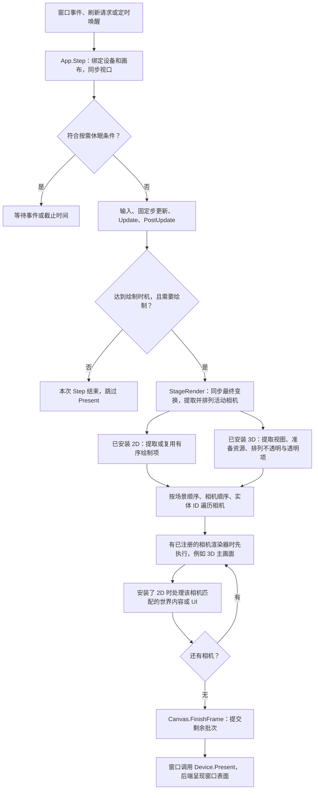
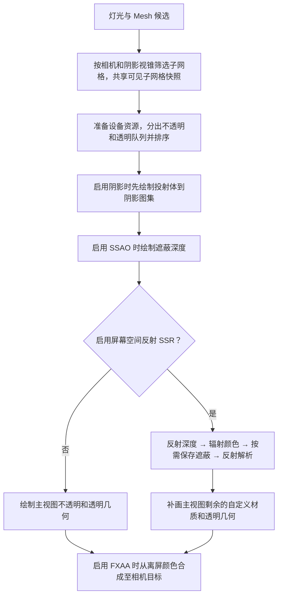

# 2D 与 3D 渲染流程

## 一帧如何到达屏幕



2D 和 3D 提取框表示可选的系统依赖。相机绘制遵循同一份有序列表。引擎内 HTML 在更新阶段处理样式和布局，把绘制结果发布为 UI 实体或 `UIPaintList2D`，随后进入 2D 提取。离屏目标可供后续绘制采样。切换目标、部分绘制状态或图元类型时，Canvas 可以在帧中途提交批次。[帧循环](../../app_ecs.go) · [系统依赖](../../app_systems.go) · [HTML 绘制列表](../../ui/html/paint_list.go) · [相机提取](../../scene/render_world.go) · [相机执行](../../scene/render_registered.go) · [Canvas](../../graphics/canvas2d.go) · [窗口呈现](../../window/event_loop.go)

提交时，Sprite 和 Shape 走各自的实例批次，3D 会合并连续且状态兼容的网格实例。纹理和静态网格在需要时取得当前设备的句柄，动态几何和实例数据随批次交给驱动。具体构建使用 OpenGL/ES、Vulkan、Metal、DirectX、WebGL2 或 WebGPU 后端。以 Vulkan 为例，帧末提交命令缓冲，再呈现交换链图像。[设备接口](../../render/device.go) · [3D 实例合并](../../scene/render3d/renderer.go) · [Vulkan 提交与呈现](../../render/vulkan_native.c)

### 2D 绘制的三条常用路径

| 内容变化 | CPU 准备 | 画面输出 |
| --- | --- | --- |
| 静止的可缓存 UI，窗口仍要求出帧 | 复用保留树和瓦片内容 | 直接采样缓存纹理。瓦片仍在原槽位时只画一个全屏四边形 |
| 局部改色、移动、显隐 | 稀疏更新沿用顺序，合成器根据旧、新边界更新受影响瓦片和遮挡关系。成员或顺序变化可触发重建 | 一个离屏目标内按裁剪区域重画脏瓦片，再合成到窗口。完全遮挡的改动可能无需重画瓦片 |
| 密集内容更新、世界精灵、透明叠加或其他不满足缓存条件的输出 | 密集内容可切换为顺序收集和排序。保留树有效但合成不适用时，仍可复用绘制项 | 按相机过滤并按绘制顺序提交。Sprite、Shape、Mesh 使用各自的批次 |

瓦片为 128 × 128，默认缓存预算 64 MiB。合成器要求相机输出到窗口、负责不透明清屏、使用预乘 Alpha 混合，且可见绘制项支持缓存。已有窗口相机先绘制时，后续叠加层走直接绘制。单个可缓存且宽高都不超过 128 像素的绘制项也直接绘制。瓦片槽位会在滚动时复用，槽位发生重排后按瓦片采样输出。[保留树](../../scene/render_retained2d.go) · [瓦片合成与回退](../../scene/render_composite2d.go) · [局部损伤](../../scene/render_composite_damage2d.go)

### 一台 3D 相机的几何与效果顺序



3D 的透明项按距离从远到近排序。主视锥外的物体仍可能投影到画面内。点光源可需要六个阴影视图，方向光按级联分配视图。FXAA 处理该相机的完整颜色，随后才叠加相应 UI。[提取、排序与绘制](../../scene/render3d/renderer.go) · [阴影](../../scene/render3d/shadows.go) · [SSAO](../../scene/render3d/ssao.go) · [SSR](../../scene/render3d/ssr.go) · [FXAA](../../scene/render3d/fxaa.go)

## 性能测量

```sh
go test ./scene -run '^$' -bench '^BenchmarkIncrementalRender2D$/^10000$' -benchtime=300ms -benchmem -count=3
go test ./scene/render3d -run '^$' -bench '^BenchmarkRender3DPreparedFrame$/^1000$' -benchtime=300ms -benchmem -count=3
```

在同一场景、分辨率、后端和画质下记录 CPU 中位数及 p95、Go 分配、draw calls、上传字节和脏瓦片像素。GPU pass 时间与 Present 等待分别采集。静态缓存、稀疏更新、全量更新和多相机分别对照。用回归用例核对渲染顺序、像素和设备重建。[提交统计](../../render/statistics.go) · [合成回归](../../scene/render_composite_damage2d_test.go) · [3D 回归](../../scene/render3d/renderer_test.go)
